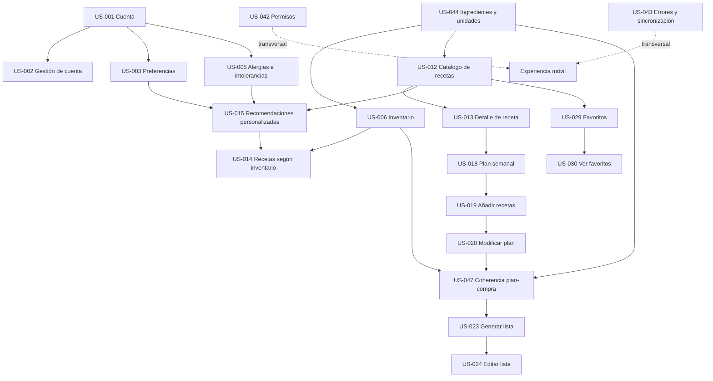

# Product Backlog — Asistente personal de cocina

**Versión:** especificación funcional inicial  
**Estado:** MVP seleccionado como alcance inicial  
**Plataformas objetivo:** iOS y Android

## 1. Visión del producto

Ayudar a las personas a decidir qué cocinar cada día aprovechando los alimentos disponibles en casa, respetando sus preferencias alimentarias y planificando sus comidas de forma práctica, saludable y económica.

### Objetivos principales

1. Reducir el esfuerzo necesario para decidir qué cocinar.
2. Evitar desperdiciar alimentos que ya están en la nevera o la despensa.
3. Personalizar las recomendaciones según las necesidades de cada usuario.
4. Organizar las comidas de la semana y generar listas de compra útiles.
5. Comparar el coste estimado de la compra entre supermercados.
6. Crear una comunidad donde los usuarios compartan recetas y experiencias.

### Principios del backlog

- **Centrado en el usuario:** cada historia expresa una necesidad y el valor que aporta.
- **Orientado a resultados:** los criterios de aceptación definen cómo comprobar que una historia funciona.
- **Incremental:** las funcionalidades complejas se dividen en capacidades verificables.
- **Priorizado:** se distingue entre las funcionalidades esenciales para una primera versión y las ampliaciones posteriores.
- **Independiente de la tecnología:** se especifica qué debe hacer el producto, no cómo construirlo.

### Convenciones de prioridad

- **P0 — MVP:** esencial para validar la propuesta de valor de la primera versión.
- **P1 — Alta:** importante para completar la experiencia principal tras el MVP.
- **P2 — Evolutiva:** ampliación que aporta valor, pero puede esperar a disponer de una primera versión funcional.

Las prioridades son una propuesta inicial y podrán cambiar según la validación con usuarios, los riesgos y las dependencias.

---

## 2. Mapa de épicas

| ID | Épica | Objetivo |
|---|---|---|
| EP-01 | Cuenta y perfil del usuario | Identidad, preferencias y restricciones alimentarias. |
| EP-02 | Inventario doméstico | Registro de alimentos, escaneo de códigos y reconocimiento visual. |
| EP-03 | Catálogo y descubrimiento de recetas | Búsqueda, información nutricional y recomendaciones personalizadas. |
| EP-04 | Planificación semanal | Organización de recetas por día y tipo de comida. |
| EP-05 | Lista de compra y comparación de precios | Ingredientes pendientes, cantidades, precios y supermercados. |
| EP-06 | Recetas favoritas y acceso sin conexión | Colección personal y disponibilidad offline. |
| EP-07 | Creación y publicación de recetas | Contenido aportado por los usuarios. |
| EP-08 | Valoraciones y comunidad | Reseñas, puntuaciones y confianza en las recetas. |
| EP-09 | Experiencia móvil y notificaciones | Permisos, estados de la aplicación y recordatorios. |
| EP-10 | Calidad y gestión del contenido | Integridad de datos, moderación y fiabilidad de la información. |

# 3. Product backlog detallado

## EP-01. Cuenta y perfil del usuario

**Objetivo:** permitir que cada usuario tenga una identidad propia y un perfil que sirva para personalizar toda la experiencia.

### US-001 — Registrarse e iniciar sesión
**Prioridad:** P0 — MVP

**Historia de usuario:** Como usuario, quiero registrarme e iniciar sesión, con mi cuenta de Google o con mi email y una contraseña, para acceder a mis datos personales y utilizar las funcionalidades de la aplicación.

**Criterios de aceptación**
- El usuario puede iniciar sesión mediante Google.
- Si es su primer acceso, se crea su cuenta y se inicia su sesión.
- Si ya tiene una cuenta, accede a ella sin duplicarla.
- Si cancela el proceso o se produce un error, recibe información clara y puede intentarlo de nuevo.
- Los datos personales, las recetas creadas y las preferencias quedan asociados a su cuenta.
- El usuario puede cerrar sesión.
- El usuario puede registrarse con su nombre, su email y una contraseña.
- El usuario puede iniciar sesión con su email y su contraseña.
- No pueden existir dos cuentas con el mismo email, sea cual sea el método de acceso.
- Si los datos no son válidos, el email ya está registrado o las credenciales son incorrectas, recibe información clara y puede corregirlo.
- La contraseña nunca se almacena ni se muestra en claro.

**Notas**
- La verificación del email y la recuperación de la contraseña quedan fuera de esta historia, pendientes de disponer de un servicio de envío de correo.
- La contraseña y Google son métodos de acceso de una misma cuenta y pueden estar disponibles a la vez. Iniciar sesión con Google con el email de una cuenta creada con contraseña la vincula a Google y conserva la contraseña: el usuario puede entrar con cualquiera de los dos.
- Una cuenta creada con Google no tiene contraseña hasta que el usuario la añade desde la gestión de su cuenta (US-002).

### US-002 — Gestionar la cuenta personal
**Prioridad:** P0 — MVP

**Historia de usuario:** Como usuario, quiero consultar y gestionar mi cuenta para mantener el control sobre mis datos.

**Criterios de aceptación**
- Puedo consultar los datos básicos de mi cuenta.
- Puedo acceder a las opciones de cierre de sesión y eliminación de cuenta.
- Puedo consultar qué métodos de acceso tiene mi cuenta (contraseña y Google).
- Si mi cuenta no tiene contraseña, puedo añadir una.
- Puedo cambiar mi contraseña.
- Puedo vincular mi cuenta de Google si no lo está.
- Puedo quitar un método de acceso siempre que la cuenta conserve al menos otro.
- Antes de eliminarla, se solicita confirmación y se informa de las consecuencias.
- La eliminación sigue la política de conservación y supresión de datos del producto, incluyendo el tratamiento de recetas publicadas y reseñas.

**Notas**
- La política de conservación y supresión de datos está definida en `docs/data-retention-policy.md`: el borrado es inmediato y definitivo, los datos privados se eliminan y las recetas publicadas y las reseñas se conservan sin autor.
- Las acciones sensibles (cambiar o quitar la contraseña, desvincular Google y eliminar la cuenta) piden la contraseña actual cuando la cuenta tiene una.
- Solo se puede vincular la cuenta de Google cuyo email coincide con el de la cuenta.

### US-003 — Configurar mis preferencias alimentarias
**Prioridad:** P0 — MVP

**Historia de usuario:** Como usuario, quiero indicar mis gustos y preferencias alimentarias para recibir recetas que encajen con mis necesidades.

**Criterios de aceptación**
- Puedo seleccionar alimentos e ingredientes que me gustan y que prefiero evitar.
- Puedo indicar mis preferencias dietéticas, como vegetariana, vegana u otras opciones disponibles.
- Puedo modificar mis preferencias en cualquier momento.
- Las recomendaciones tienen en cuenta las preferencias guardadas.
- Si no he configurado mi perfil, puedo seguir utilizando la aplicación con recomendaciones generales.

### US-004 — Configurar mis objetivos nutricionales
**Prioridad:** P1 — Alta

**Historia de usuario:** Como usuario, quiero configurar mis objetivos nutricionales para descubrir recetas compatibles con mis necesidades.

**Criterios de aceptación**
- Puedo indicar un objetivo calórico diario o por comida.
- Puedo especificar otros objetivos nutricionales que la aplicación admita, como proteínas o macronutrientes.
- Puedo modificar o desactivar mis objetivos.
- Las recomendaciones y los detalles nutricionales reflejan los objetivos configurados cuando hay datos suficientes.

### US-005 — Gestionar alergias e intolerancias
**Prioridad:** P0 — MVP

**Historia de usuario:** Como usuario con alergias o intolerancias, quiero indicar los ingredientes que debo evitar para reducir el riesgo de seleccionar una receta inadecuada.

**Criterios de aceptación**
- Puedo registrar alergias e intolerancias de una lista de ingredientes y alérgenos admitidos.
- Las recetas que contengan un alérgeno identificado se excluyen de las recomendaciones ordinarias o se identifican claramente como no aptas.
- Si una receta carece de información suficiente para verificar su seguridad, la aplicación no la presenta como segura.
- Puedo modificar mis restricciones cuando sea necesario.
- La aplicación distingue entre preferencias personales y restricciones de seguridad.

**Nota de alcance:** las alergias deben tratarse como restricciones estrictas, no como simples preferencias. La ausencia de un ingrediente en una lista no demuestra por sí sola que un producto sea seguro frente a contaminación cruzada.

---

## EP-02. Inventario doméstico

**Objetivo:** permitir que el usuario registre los alimentos que tiene disponibles y que el sistema utilice ese inventario para sugerir recetas y calcular lo que necesita comprar.

### US-006 — Registrar alimentos manualmente
**Prioridad:** P0 — MVP

**Historia de usuario:** Como usuario, quiero registrar manualmente los alimentos que tengo en casa para obtener recetas basadas en mis existencias.

**Criterios de aceptación**
- Puedo buscar y seleccionar un alimento de un catálogo disponible.
- Puedo indicar su cantidad y unidad de medida.
- Puedo guardar el alimento en mi inventario.
- Puedo consultar, editar y eliminar los alimentos registrados.
- El inventario se actualiza después de cada operación confirmada.

### US-007 — Registrar la caducidad y ubicación de los alimentos
**Prioridad:** P1 — Alta

**Historia de usuario:** Como usuario, quiero registrar la fecha de caducidad o consumo preferente y la ubicación de mis alimentos para gestionarlos mejor.

**Criterios de aceptación**
- Puedo indicar una fecha cuando la conozca.
- Puedo clasificar los alimentos por ubicación, como nevera, congelador o despensa.
- Puedo consultar los alimentos próximos a caducar.
- El sistema diferencia los alimentos sin fecha registrada de los que tienen una fecha conocida.

### US-008 — Escanear códigos de barras
**Prioridad:** P1 — Alta

**Historia de usuario:** Como usuario, quiero escanear el código de barras de un producto para registrarlo rápidamente en mi inventario.

**Criterios de aceptación**
- Puedo abrir el escáner desde el flujo de registro de alimentos.
- Cuando el código se reconoce y existe en el catálogo, se muestran los datos del producto.
- Puedo confirmar la cantidad antes de añadirlo.
- Si el código no está registrado, puedo introducir los datos manualmente.
- Si no se concede permiso para utilizar la cámara, se ofrece una alternativa manual.

### US-009 — Identificar alimentos a partir de una fotografía
**Prioridad:** P1 — Alta

**Historia de usuario:** Como usuario, quiero fotografiar el interior de mi nevera o despensa para registrar los alimentos que aparecen en la imagen sin tener que introducirlos uno por uno.

**Criterios de aceptación**
- Puedo tomar una fotografía o seleccionar una imagen disponible en el dispositivo.
- La aplicación presenta una propuesta de alimentos detectados.
- Puedo confirmar, corregir o descartar cada elemento antes de añadirlo.
- Si un alimento no puede identificarse con suficiente confianza, se marca como incierto y no se registra automáticamente como confirmado.
- Puedo continuar manualmente si el análisis falla.

### US-010 — Actualizar el inventario después de cocinar
**Prioridad:** P1 — Alta

**Historia de usuario:** Como usuario, quiero actualizar mi inventario después de preparar una receta para mantener las existencias lo más cercanas posible a la realidad.

**Criterios de aceptación**
- Al preparar una receta, puedo indicar que he utilizado los ingredientes correspondientes.
- El sistema calcula las cantidades que deberían descontarse a partir de la receta y las raciones seleccionadas.
- Puedo confirmar o corregir el consumo antes de aplicarlo.
- No se descuentan cantidades sin una acción confirmada por el usuario.
- Si no hay existencias suficientes o la cantidad es desconocida, el sistema lo indica sin generar cantidades negativas inadvertidamente.

### US-011 — Consultar alimentos que conviene consumir pronto
**Prioridad:** P2 — Evolutiva

**Historia de usuario:** Como usuario, quiero identificar los alimentos próximos a caducar para priorizarlos en mis comidas.

**Criterios de aceptación**
- Puedo consultar los alimentos ordenados por proximidad a su fecha registrada.
- Puedo descubrir recetas que permitan utilizar esos alimentos.
- El sistema diferencia entre fechas registradas y estimaciones.
- Las sugerencias no sustituyen la comprobación de que un alimento sea apto para el consumo.

---

## EP-03. Catálogo y descubrimiento de recetas

**Objetivo:** proporcionar recetas útiles, comprensibles y personalizadas a partir del inventario y del perfil del usuario.

### US-012 — Consultar el catálogo de recetas
**Prioridad:** P0 — MVP

**Historia de usuario:** Como usuario, quiero explorar un catálogo de recetas para descubrir platos que pueda preparar.

**Criterios de aceptación**
- Puedo consultar una selección de recetas.
- Cada receta presenta, como mínimo, nombre, imagen cuando esté disponible, tiempo estimado, ingredientes principales y valoración cuando existan reseñas.
- Puedo abrir una receta para consultar su información completa.
- Las recetas sin valoración se muestran como tales, sin asignarles una puntuación ficticia.

### US-013 — Consultar el detalle de una receta
**Prioridad:** P0 — MVP

**Historia de usuario:** Como usuario, quiero consultar los ingredientes, las cantidades, las instrucciones y la información nutricional de una receta antes de prepararla.

**Criterios de aceptación**
- Se muestran los ingredientes y sus cantidades para el número de raciones indicado.
- Se muestran los pasos de preparación en un orden comprensible.
- Se indica el tiempo estimado de elaboración.
- Se presentan las calorías y demás valores nutricionales disponibles, indicando cuando sean estimaciones.
- Se muestran las valoraciones y reseñas publicadas.
- Si falta información, se indica claramente en lugar de inventarla.

### US-014 — Recibir recetas basadas en mi inventario
**Prioridad:** P0 — MVP

**Historia de usuario:** Como usuario, quiero recibir recetas que aprovechen los alimentos que tengo en casa para reducir el esfuerzo de decidir qué cocinar y evitar compras innecesarias.

**Criterios de aceptación**
- Las recomendaciones tienen en cuenta los alimentos registrados en mi inventario.
- Puedo distinguir las recetas que puedo preparar con lo disponible de aquellas para las que faltan ingredientes.
- Se indican los ingredientes que faltan para preparar cada receta.
- Puedo consultar alternativas que aprovechen mejor mis existencias.
- Si el inventario es insuficiente para generar recomendaciones útiles, se ofrece una alternativa, como explorar el catálogo.

### US-015 — Recibir recomendaciones personalizadas
**Prioridad:** P0 — MVP

**Historia de usuario:** Como usuario, quiero recibir recetas adaptadas a mis gustos, restricciones alimentarias y objetivos nutricionales para encontrar platos adecuados para mí.

**Criterios de aceptación**
- Las recomendaciones consideran mis preferencias alimentarias y mis objetivos configurados.
- Las alergias y restricciones de seguridad se respetan como condiciones obligatorias.
- Las recetas pueden ordenarse o filtrarse por criterios como tiempo de preparación y calorías.
- Puedo indicar que una recomendación no me interesa.
- Si no hay suficientes recetas compatibles, se informa de ello en lugar de presentar resultados incompatibles como adecuados.

### US-016 — Filtrar y buscar recetas
**Prioridad:** P1 — Alta

**Historia de usuario:** Como usuario, quiero buscar y filtrar recetas para encontrar rápidamente platos que cumplan mis criterios.

**Criterios de aceptación**
- Puedo buscar por nombre o ingrediente.
- Puedo filtrar por tiempo de preparación, tipo de plato, calorías y preferencias dietéticas disponibles.
- Los filtros pueden combinarse.
- Los resultados respetan las restricciones de seguridad de mi perfil.
- Puedo retirar los filtros para volver a explorar el catálogo completo que resulte apto.

### US-017 — Encontrar sustitutos para ingredientes
**Prioridad:** P2 — Evolutiva

**Historia de usuario:** Como usuario, quiero conocer posibles sustitutos para un ingrediente que no tengo o que prefiero evitar, para adaptar una receta a mis circunstancias.

**Criterios de aceptación**
- La aplicación propone sustituciones para los ingredientes que tengan alternativas adecuadas.
- Se informa de cómo cambia la cantidad o preparación cuando corresponda.
- Se actualiza la lista de ingredientes necesarios.
- Las sustituciones respetan las restricciones alimentarias conocidas.
- Si no existe una alternativa fiable, se indica que no se dispone de una sugerencia validada.

---

## EP-04. Planificación semanal

**Objetivo:** transformar las recomendaciones en un plan de comidas que el usuario pueda organizar y utilizar para generar su compra.

### US-018 — Crear un plan semanal de comidas
**Prioridad:** P0 — MVP

**Historia de usuario:** Como usuario, quiero planificar las comidas de mi semana para organizar lo que voy a cocinar con antelación.

**Criterios de aceptación**
- Puedo consultar un plan organizado por días de la semana.
- Puedo asignar recetas a días y tipos de comida, como desayuno, almuerzo o cena.
- Puedo consultar las recetas que he planificado.
- Puedo modificar o eliminar una asignación.
- El plan se conserva al cerrar y volver a abrir la aplicación.

### US-019 — Añadir recetas al plan desde las recomendaciones
**Prioridad:** P0 — MVP

**Historia de usuario:** Como usuario, quiero añadir una receta recomendada a mi planificación sin tener que volver a buscarla.

**Criterios de aceptación**
- Puedo seleccionar una receta y asignarla a un día y tipo de comida.
- Puedo indicar el número de raciones.
- La aplicación confirma que la receta se ha añadido.
- La receta aparece en el plan correspondiente.
- Puedo evitar duplicados accidentales o confirmar si deseo planificar el mismo plato varias veces.

### US-020 — Modificar y reorganizar el plan semanal
**Prioridad:** P0 — MVP

**Historia de usuario:** Como usuario, quiero mover, sustituir y eliminar recetas de mi planificación para adaptarla a cambios de última hora.

**Criterios de aceptación**
- Puedo cambiar la fecha o el tipo de comida de una receta.
- Puedo sustituir una receta por otra.
- Puedo eliminar una receta sin eliminarla del catálogo ni de mis favoritos.
- La lista de compra refleja los cambios en el plan.
- Los cambios confirmados se conservan.

### US-021 — Ajustar las raciones del plan
**Prioridad:** P1 — Alta

**Historia de usuario:** Como usuario, quiero ajustar el número de raciones de cada receta para adaptar el plan a las personas que van a comer.

**Criterios de aceptación**
- Puedo indicar el número de raciones deseado.
- Las cantidades de ingredientes se recalculan proporcionalmente cuando la receta lo permite.
- La lista de compra utiliza las cantidades ajustadas.
- Las calorías por ración se distinguen de las calorías totales del plato.

### US-022 — Generar una propuesta de menú semanal
**Prioridad:** P1 — Alta

**Historia de usuario:** Como usuario, quiero obtener una propuesta de menú para toda la semana para ahorrar tiempo en la planificación.

**Criterios de aceptación**
- La propuesta tiene en cuenta mis preferencias, restricciones y objetivos.
- Se consideran las recetas compatibles con mi inventario.
- Puedo revisar la propuesta antes de aceptarla.
- Puedo sustituir recetas individualmente sin tener que generar de nuevo todo el plan.
- Las alergias y restricciones obligatorias se respetan en todas las propuestas.

---

## EP-05. Lista de compra y comparación de precios

**Objetivo:** convertir la planificación en una lista de ingredientes pendientes y ayudar al usuario a estimar cuánto le costará comprar lo necesario.

### US-023 — Generar la lista de compra semanal
**Prioridad:** P0 — MVP

**Historia de usuario:** Como usuario, quiero generar una lista de compra a partir de mi plan semanal para conocer todos los ingredientes que necesito adquirir.

**Criterios de aceptación**
- La lista incluye los ingredientes necesarios para las recetas planificadas.
- Los ingredientes repetidos se consolidan cuando pueden combinarse de forma segura y coherente.
- Se tienen en cuenta las cantidades y raciones seleccionadas.
- Se excluyen o descuentan las cantidades que el usuario tiene disponibles en el inventario.
- Los ingredientes cuya disponibilidad sea desconocida se identifican claramente.
- Cuando cambia el plan, puedo actualizar la lista para reflejar los cambios.

### US-024 — Gestionar la lista de compra manualmente
**Prioridad:** P0 — MVP

**Historia de usuario:** Como usuario, quiero editar mi lista de compra para adaptarla a lo que finalmente voy a adquirir.

**Criterios de aceptación**
- Puedo añadir productos que no procedan de ninguna receta.
- Puedo eliminar elementos y modificar cantidades.
- Puedo marcar productos como comprados.
- Puedo consultar los elementos pendientes.
- Las modificaciones manuales no alteran inadvertidamente las recetas originales ni el inventario.

### US-025 — Consultar el precio estimado de la compra por supermercado
**Prioridad:** P1 — Alta

**Historia de usuario:** Como usuario, quiero comparar el coste estimado de mi lista de compra en distintos supermercados para elegir dónde comprar al mejor precio.

**Criterios de aceptación**
- Puedo consultar el coste estimado de los productos disponibles en cada supermercado admitido.
- Los precios corresponden a productos comparables y a cantidades suficientes para cubrir la compra.
- Se identifican los productos sin precio disponible o sin una equivalencia fiable.
- Se muestra el subtotal de los productos con precio conocido y se indica cualquier parte no cotizada.
- Se especifican la fecha o actualidad de los precios y las condiciones relevantes de la estimación.
- La aplicación no presenta como total exacto un cálculo que incluya productos sin precio conocido.

### US-026 — Comparar productos equivalentes entre supermercados
**Prioridad:** P1 — Alta

**Historia de usuario:** Como usuario, quiero ver qué productos de mi lista corresponden a los disponibles en cada supermercado para comparar precios de forma justa.

**Criterios de aceptación**
- Se muestran las correspondencias entre los ingredientes requeridos y los productos comerciales encontrados.
- Se consideran las diferencias de formato, peso, volumen y número de unidades.
- Se puede comparar el precio del paquete y, cuando sea útil, el precio por unidad de medida.
- Se indica cuándo una equivalencia es aproximada.
- Si un producto no tiene una equivalencia fiable, se solicita o permite una selección manual.

### US-027 — Elegir supermercado y consultar alternativas de compra
**Prioridad:** P2 — Evolutiva

**Historia de usuario:** Como usuario, quiero seleccionar un supermercado y descubrir alternativas para completar mi lista de compra al menor coste posible.

**Criterios de aceptación**
- Puedo seleccionar un supermercado como preferido.
- Puedo consultar alternativas de productos que cumplan la necesidad de la receta.
- Puedo comparar el coste estimado de distintas opciones de compra.
- Las alternativas respetan las restricciones alimentarias y las cantidades necesarias.
- Los gastos de desplazamiento, entrega, promociones y otros costes solo se incluyen si hay información disponible y se identifican claramente.

### US-028 — Marcar una compra como completada
**Prioridad:** P1 — Alta

**Historia de usuario:** Como usuario, quiero marcar mi compra como completada para controlar qué productos he adquirido.

**Criterios de aceptación**
- Puedo marcar los productos individualmente como comprados.
- Puedo consultar el progreso de la lista.
- Puedo conservar o archivar una lista completada.
- Puedo utilizar la compra como referencia para actualizar mi inventario, sin asumir que todos los productos comprados ya están registrados en casa.

---

## EP-06. Recetas favoritas y acceso sin conexión

**Objetivo:** permitir que el usuario conserve recetas importantes y pueda consultarlas sin depender de una conexión a Internet.

### US-029 — Guardar una receta como favorita
**Prioridad:** P0 — MVP

**Historia de usuario:** Como usuario, quiero guardar mis recetas favoritas para acceder a ellas rápidamente.

**Criterios de aceptación**
- Puedo añadir una receta a mis favoritos desde su detalle.
- Puedo retirarla de favoritos en cualquier momento.
- Mis favoritos se conservan asociados a mi cuenta.
- Guardar una receta como favorita no la añade automáticamente al plan semanal.

### US-030 — Consultar mi colección de favoritos
**Prioridad:** P0 — MVP

**Historia de usuario:** Como usuario, quiero consultar mis recetas favoritas desde una sección específica para encontrarlas fácilmente.

**Criterios de aceptación**
- Existe una sección dedicada a las recetas favoritas.
- Puedo abrir el detalle de una receta desde esa sección.
- Puedo retirar recetas de la colección.
- Se muestra un estado vacío útil cuando todavía no hay favoritos.

### US-031 — Consultar recetas favoritas sin conexión
**Prioridad:** P1 — Alta

**Historia de usuario:** Como usuario, quiero acceder sin conexión a las recetas que he guardado para poder cocinar incluso cuando no disponga de Internet.

**Criterios de aceptación**
- Puedo guardar localmente los datos necesarios de una receta para su consulta offline.
- Sin conexión, puedo acceder a los ingredientes, cantidades e instrucciones que se hayan guardado.
- La aplicación informa si una receta todavía no está disponible offline.
- Los cambios en recetas remotas se sincronizan cuando vuelve a haber conexión, respetando las reglas de actualización del producto.
- Las funciones que necesitan conexión, como consultar precios actuales, se identifican como no disponibles offline.

---

## EP-07. Creación y publicación de recetas

**Objetivo:** permitir que los usuarios creen sus propias recetas, las utilicen en sus planes y las compartan con otros usuarios.

### US-032 — Crear una receta propia
**Prioridad:** P1 — Alta

**Historia de usuario:** Como usuario, quiero crear una receta con mis propios ingredientes e instrucciones para incorporarla a mi colección personal.

**Criterios de aceptación**
- Puedo indicar el nombre, la descripción, los ingredientes y sus cantidades.
- Puedo especificar las raciones, el tiempo estimado y los pasos de preparación.
- Puedo añadir una imagen cuando lo desee.
- Puedo guardar una receta como borrador antes de publicarla.
- Se validan los campos obligatorios antes de guardar.

### US-033 — Editar y eliminar mis recetas
**Prioridad:** P1 — Alta

**Historia de usuario:** Como autor de una receta, quiero editarla o eliminarla para mantenerla actualizada.

**Criterios de aceptación**
- Puedo modificar las recetas que he creado.
- Puedo eliminar una receta propia previa confirmación.
- Las modificaciones no alteran las recetas creadas por otros usuarios.
- Si una receta ya está planificada o guardada por otros usuarios, el sistema gestiona los cambios sin provocar pérdidas inesperadas de información.

### US-034 — Publicar una receta para otros usuarios
**Prioridad:** P1 — Alta

**Historia de usuario:** Como usuario, quiero publicar mis recetas para compartirlas con la comunidad y permitir que otros las descubran.

**Criterios de aceptación**
- Puedo publicar una receta que cumpla los requisitos establecidos.
- Las recetas publicadas pueden aparecer en el catálogo y en las búsquedas.
- Se muestra la autoría de la receta.
- Puedo consultar el estado de publicación.
- Una receta incompleta o que no cumpla las reglas de publicación no se publica hasta resolver los problemas indicados.

### US-035 — Utilizar recetas propias en el plan semanal
**Prioridad:** P1 — Alta

**Historia de usuario:** Como usuario, quiero añadir mis propias recetas a la planificación semanal para organizar también los platos que no proceden del catálogo general.

**Criterios de aceptación**
- Puedo planificar mis recetas personales del mismo modo que las recetas del catálogo.
- Las cantidades y raciones se utilizan para calcular las necesidades de compra.
- Las recetas propias pueden guardarse como favoritas cuando corresponda.
- Si faltan datos necesarios para calcular cantidades, la aplicación identifica esa limitación.

### US-036 — Obtener información nutricional y cotizar recetas propias
**Prioridad:** P1 — Alta

**Historia de usuario:** Como usuario, quiero obtener una estimación nutricional y del coste de los ingredientes de mis recetas para evaluar su adecuación a mi perfil y presupuesto.

**Criterios de aceptación**
- El sistema calcula una estimación nutricional a partir de ingredientes y cantidades identificables.
- Puedo consultar el coste estimado de los ingredientes con precios disponibles.
- Se distinguen los datos estimados de los valores verificados.
- Los ingredientes ambiguos o no reconocidos se señalan para su corrección.
- Las cotizaciones utilizan los mismos criterios de comparación que la lista de compra.

---

## EP-08. Valoraciones y comunidad

**Objetivo:** aprovechar las experiencias de otros usuarios para ayudar a elegir recetas y fomentar la participación.

### US-037 — Valorar una receta
**Prioridad:** P1 — Alta

**Historia de usuario:** Como usuario, quiero valorar una receta que he preparado para expresar mi experiencia y ayudar a otros usuarios a elegir.

**Criterios de aceptación**
- Puedo asignar una puntuación dentro de una escala definida.
- La aplicación vincula la valoración a mi cuenta y a la receta correspondiente.
- Puedo modificar mi valoración.
- La puntuación media se recalcula cuando se publica, modifica o elimina una valoración.
- Una misma cuenta no puede generar múltiples valoraciones independientes de la misma receta.

### US-038 — Escribir una reseña
**Prioridad:** P1 — Alta

**Historia de usuario:** Como usuario, quiero escribir una reseña sobre una receta para compartir qué tal fue prepararla y el resultado obtenido.

**Criterios de aceptación**
- Puedo añadir un comentario junto a mi valoración.
- Puedo editar o eliminar mi propia reseña.
- Las reseñas publicadas muestran la información de autoría permitida por el producto.
- Se aplican las reglas de contenido y moderación.
- Puedo identificar la diferencia entre una reseña escrita y una valoración sin comentario.

### US-039 — Consultar valoraciones y reseñas
**Prioridad:** P1 — Alta

**Historia de usuario:** Como usuario, quiero leer las opiniones de otras personas antes de preparar una receta para decidir si me interesa.

**Criterios de aceptación**
- Puedo consultar la puntuación media y el número de valoraciones.
- Puedo leer las reseñas publicadas.
- Si no hay valoraciones, se indica expresamente.
- Las reseñas no se presentan como experiencias verificadas si el sistema no puede acreditar que la receta se haya preparado.
- Los contenidos retirados por moderación no aparecen como reseñas públicas activas.

### US-040 — Denunciar contenido inapropiado
**Prioridad:** P2 — Evolutiva

**Historia de usuario:** Como usuario, quiero denunciar una receta o reseña inapropiada para contribuir a mantener una comunidad fiable.

**Criterios de aceptación**
- Puedo denunciar un contenido y seleccionar un motivo.
- La denuncia queda registrada para su revisión.
- Puedo conocer que la denuncia se ha enviado.
- Denunciar un contenido no implica su eliminación automática.
- Se aplican reglas de moderación consistentes con las políticas del producto.

---

## EP-09. Experiencia móvil y notificaciones

**Objetivo:** completar los flujos principales de la aplicación móvil y mantener una experiencia coherente en iOS y Android.

### US-041 — Recibir recordatorios de planificación
**Prioridad:** P2 — Evolutiva

**Historia de usuario:** Como usuario, quiero recibir recordatorios de las comidas que he planificado para organizar mi tiempo de preparación.

**Criterios de aceptación**
- Puedo activar o desactivar los recordatorios.
- Puedo configurar cuándo deseo recibirlos.
- Las notificaciones hacen referencia a comidas existentes en mi planificación.
- Los cambios en el plan se reflejan en los recordatorios pendientes.
- Si no concedo permisos de notificación, puedo seguir utilizando la aplicación.

### US-042 — Gestionar los permisos del dispositivo
**Prioridad:** P0 — MVP

**Historia de usuario:** Como usuario, quiero comprender y controlar los permisos que utiliza la aplicación para decidir qué acceso concedo a mi dispositivo.

**Criterios de aceptación**
- La aplicación solicita acceso a la cámara únicamente cuando una funcionalidad lo necesita.
- Si se utiliza una galería de imágenes, el acceso se solicita en el contexto correspondiente.
- Si niego un permiso, puedo seguir utilizando las funciones que no dependan de él.
- Se explica cómo proceder cuando un permiso es necesario y está desactivado.

### US-043 — Gestionar los errores de conexión y sincronización
**Prioridad:** P0 — MVP

**Historia de usuario:** Como usuario, quiero saber cuándo una operación no se ha completado para evitar perder cambios o asumir que una acción ha tenido éxito.

**Criterios de aceptación**
- Los errores relevantes se muestran con mensajes comprensibles.
- Las operaciones no confirmadas no se presentan como completadas.
- Cuando es posible, puedo volver a intentar una operación fallida.
- Los datos introducidos no se pierden innecesariamente tras un error.
- La aplicación distingue las funciones disponibles sin conexión de las que requieren conectividad.

---

## EP-10. Calidad y gestión del contenido

**Objetivo:** asegurar que los datos utilizados para recomendar recetas, calcular cantidades y comparar precios sean coherentes y fiables.

### US-044 — Gestionar ingredientes y unidades de medida coherentes
**Prioridad:** P0 — MVP

**Historia de usuario:** Como usuario, quiero que la aplicación reconozca ingredientes equivalentes y sus unidades de medida para obtener listas de compra consistentes.

**Criterios de aceptación**
- Los ingredientes equivalentes pueden agruparse cuando representan el mismo producto y son compatibles.
- Las conversiones entre unidades se realizan únicamente cuando existe una equivalencia válida.
- No se combinan cantidades incompatibles sin una conversión fiable.
- Las equivalencias dudosas requieren revisión o se mantienen separadas.

### US-045 — Consultar la procedencia y actualidad de los precios
**Prioridad:** P1 — Alta

**Historia de usuario:** Como usuario, quiero conocer de cuándo son los precios y de dónde proceden para valorar la fiabilidad de una cotización.

**Criterios de aceptación**
- Los precios disponibles incluyen información sobre su fecha o periodo de actualización.
- Se identifica el supermercado al que corresponde cada precio.
- Se señalan los precios desactualizados o cuya vigencia no puede confirmarse.
- Los precios estimados se distinguen de los precios confirmados por una fuente actual.

### US-046 — Corregir errores en la información de los alimentos
**Prioridad:** P1 — Alta

**Historia de usuario:** Como usuario, quiero corregir los datos de los alimentos detectados o seleccionados para mantener mi inventario y mis recetas precisos.

**Criterios de aceptación**
- Puedo corregir el nombre, la cantidad y otros campos editables.
- Las correcciones se reflejan en los cálculos posteriores.
- Los errores de reconocimiento no se propagan como datos confirmados sin posibilidad de revisión.
- Se conservan las unidades y cantidades de manera coherente.

### US-047 — Mantener la coherencia entre las recetas, el plan y la compra
**Prioridad:** P0 — MVP

**Historia de usuario:** Como usuario, quiero que los cambios en mi planificación se reflejen correctamente en la lista de compra para no adquirir productos innecesarios ni olvidar ingredientes.

**Criterios de aceptación**
- Añadir una receta al plan actualiza las necesidades de compra.
- Eliminar o sustituir una receta actualiza las cantidades correspondientes.
- Los cambios manuales de la lista de compra no modifican el plan de manera inesperada.
- El sistema identifica las cantidades cuya disponibilidad en el inventario sea desconocida.
- Los cálculos son reproducibles a partir de las recetas, raciones e inventario utilizados.

---

# 4. Ampliaciones potenciales del producto

Estas propuestas son oportunidades de evolución que conviene validar con usuarios antes de incorporarlas al alcance comprometido.

## A. Nutrición avanzada y seguimiento de hábitos — P1/P2
- Seguimiento de calorías y macronutrientes consumidos durante el día.
- Equilibrio nutricional de la planificación semanal.
- Recomendaciones para aumentar la variedad de alimentos.
- Objetivos nutricionales configurables a lo largo del tiempo.

**Valor:** convierte la aplicación en un asistente de alimentación continuado, más allá de un buscador de recetas.

## B. Integración con supermercados y compra online — P1/P2
- Añadir productos a un carrito de compra de un supermercado.
- Consultar disponibilidad por tienda o zona geográfica.
- Aplicar promociones y programas de fidelización cuando existan integraciones disponibles.
- Realizar seguimiento de pedidos mediante el proveedor correspondiente.

**Valor:** transforma la comparación de precios en una experiencia de compra accionable. Depende de la disponibilidad de catálogos, precios y servicios de integración de cada supermercado.

## C. Hogares compartidos — P1
- Compartir una despensa entre varios miembros del hogar.
- Crear planes semanales colaborativos.
- Compartir listas de compra y marcar productos adquiridos.
- Gestionar preferencias y restricciones de varios comensales simultáneamente.

**Valor:** hace que el producto sea útil para parejas, familias y compañeros de piso, no solo para usuarios individuales.

## D. Asistente durante la preparación — P2
- Modo de cocina con pasos individuales y navegación sencilla.
- Temporizadores vinculados a los pasos de la receta.
- Ajuste dinámico de cantidades durante la preparación.
- Instrucciones por voz y manos libres.

**Valor:** acompaña al usuario mientras cocina, en lugar de limitarse a recomendar y planificar.

## E. Reducción del desperdicio alimentario — P1
- Alertas sobre alimentos próximos a caducar.
- Estadísticas de alimentos aprovechados.
- Estimación del ahorro generado al cocinar con ingredientes disponibles.
- Recomendaciones para reutilizar sobras y aprovechar ingredientes abiertos.

**Valor:** refuerza uno de los beneficios más diferenciadores de la propuesta.

## F. Comunidad y descubrimiento social — P2
- Seguir a autores de recetas.
- Crear colecciones públicas.
- Compartir recetas y planes.
- Guardar recetas recomendadas por otros usuarios.
- Descubrir tendencias y recetas populares.

**Valor:** favorece la retención y genera contenido nuevo sin depender exclusivamente de un catálogo editorial.

## G. Presupuesto y optimización de costes — P1/P2
- Definir un presupuesto semanal para alimentación.
- Generar menús que respeten el presupuesto.
- Comparar el coste por ración de diferentes recetas.
- Estimar el ahorro frente a planes alternativos.

**Valor:** convierte el precio de la compra en un criterio de decisión desde el comienzo de la planificación.

---

# 5. MVP seleccionado

Se acepta la propuesta de MVP centrada en completar el flujo principal de principio a fin:

1. Crear una cuenta.
2. Configurar preferencias y restricciones alimentarias.
3. Registrar alimentos manualmente.
4. Descubrir recetas compatibles con el inventario y el perfil.
5. Planificar las comidas de la semana.
6. Generar y gestionar una lista de compra coherente.
7. Guardar recetas favoritas.
8. Utilizar la aplicación con estados de error y permisos bien gestionados.

## Historias incluidas en el MVP

La selección inicial comprende **22 historias candidatas**. Algunas historias transversales, como US-044 y US-047, requieren especial atención durante el refinamiento para que las funciones principales sean coherentes.

| Épica | Historias |
|---|---|
| Cuenta y perfil | US-001, US-002, US-003, US-005 |
| Inventario | US-006 |
| Recetas | US-012, US-013, US-014, US-015 |
| Planificación | US-018, US-019, US-020 |
| Lista de compra | US-023, US-024 |
| Favoritos | US-029, US-030 |
| Experiencia móvil | US-042, US-043 |
| Calidad de datos | US-044, US-047 |

**Nota sobre las restricciones del MVP:** US-005 se incluye porque una recomendación personalizada no debería tratar las alergias como preferencias opcionales. El catálogo debe disponer de información suficiente para aplicar estas restricciones de forma responsable.

## Fuera del MVP inicial

- US-008: escaneo de códigos de barras.
- US-009: identificación de alimentos mediante fotografías.
- US-022: generación automática de un menú semanal.
- US-025 y US-026: comparación de precios entre supermercados.
- US-031: recetas disponibles sin conexión.
- US-032 a US-036: creación y publicación de recetas propias y cotización avanzada.
- US-037 a US-040: participación y moderación de la comunidad.
- US-041: recordatorios de planificación.
- Otras ampliaciones P1/P2 indicadas en el backlog.

La comparación de precios es una funcionalidad diferenciadora. Si constituye una de las principales razones para elegir el producto, se recomienda valorar una versión limitada en el MVP, siempre que se disponga de datos de precios fiables.

---

# 6. Orden de realización de las historias del MVP según sus dependencias

## 6.1. Criterio de ordenación

El orden siguiente no pretende imponer una metodología de implementación ni sustituir la planificación de sprint. Es una secuencia de dependencias funcionales: primero se construyen las capacidades que otras historias necesitan y después las experiencias que las utilizan.

**Importante:** no todas las historias deben terminarse por completo antes de empezar la siguiente. Se pueden refinar y desarrollar en paralelo cuando las interfaces funcionales y los datos que comparten estén acordados.

## 6.2. Secuencia recomendada

| Orden | ID | Historia | Dependencias principales | Justificación |
|---:|---|---|---|---|
| 1 | US-001 | Registrarse e iniciar sesión | Ninguna | Establece la identidad necesaria para asociar los datos del usuario. |
| 2 | US-042 | Gestionar los permisos del dispositivo | Ninguna; especialmente relevante para futuras funciones de cámara | Define la experiencia de permisos y sus alternativas. Puede trabajarse en paralelo con US-001. |
| 3 | US-002 | Gestionar la cuenta personal | US-001 | La gestión de cuenta requiere que exista una identidad de usuario. |
| 4 | US-003 | Configurar mis preferencias alimentarias | US-001 | Las preferencias deben quedar asociadas a una cuenta. |
| 5 | US-005 | Gestionar alergias e intolerancias | US-001; relacionado con US-003 | Las restricciones deben estar disponibles antes de recomendar recetas. |
| 6 | US-044 | Gestionar ingredientes y unidades de medida coherentes | Base del catálogo de ingredientes | Es esencial para representar alimentos, comparar ingredientes y calcular cantidades sin mezclar unidades incompatibles. |
| 7 | US-006 | Registrar alimentos manualmente | US-001, US-044 | El inventario depende de una identidad y de un catálogo coherente de alimentos y unidades. |
| 8 | US-012 | Consultar el catálogo de recetas | Catálogo inicial de recetas e ingredientes | Proporciona las recetas que se mostrarán y utilizarán en el resto del flujo. |
| 9 | US-013 | Consultar el detalle de una receta | US-012; datos estructurados de recetas | Permite consultar ingredientes, cantidades, instrucciones y datos nutricionales. |
| 10 | US-015 | Recibir recomendaciones personalizadas | US-003, US-005, US-012; US-013 para el detalle | Aplica preferencias y restricciones al catálogo de recetas. |
| 11 | US-014 | Recibir recetas basadas en mi inventario | US-006, US-012, US-044; US-015 para combinar personalización | Compara las necesidades de cada receta con los alimentos disponibles. |
| 12 | US-018 | Crear un plan semanal de comidas | US-001; catálogo de recetas disponible | Proporciona la estructura de días y tipos de comida. |
| 13 | US-019 | Añadir recetas al plan desde las recomendaciones | US-018, US-013, US-015; US-014 para el flujo basado en inventario | Conecta las recetas descubiertas con la planificación. |
| 14 | US-020 | Modificar y reorganizar el plan semanal | US-018, US-019 | Permite ajustar las asignaciones y exige mantener coherentes las necesidades de compra. |
| 15 | US-047 | Mantener la coherencia entre las recetas, el plan y la compra | US-006, US-018, US-019, US-020, US-044 | Define las reglas de consistencia que deben cumplir la planificación, el inventario y la lista de compra. Debe refinarse desde el principio y validarse a medida que se construyen esos módulos. |
| 16 | US-023 | Generar la lista de compra semanal | US-006, US-013, US-018, US-019, US-020, US-044, US-047 | Calcula ingredientes y cantidades necesarios y descuenta las existencias conocidas. |
| 17 | US-024 | Gestionar la lista de compra manualmente | US-023 | Permite adaptar la lista generada a las necesidades reales de compra. |
| 18 | US-029 | Guardar una receta como favorita | US-001, US-012 | Guarda la relación entre usuario y receta. Puede desarrollarse en paralelo con la planificación. |
| 19 | US-030 | Consultar mi colección de favoritos | US-029, US-013 | Permite acceder a las recetas guardadas y abrir sus detalles. |
| 20 | US-043 | Gestionar los errores de conexión y sincronización | Transversal a todas las operaciones que guardan o recuperan datos | Debe diseñarse desde el inicio y validarse en todos los flujos; se coloca aquí como hito de verificación transversal, no como una tarea que deba dejarse para el final. |

La secuencia anterior enumera 20 historias de la selección de MVP; **US-047 y US-043 deben tratarse como requisitos transversales durante todo el desarrollo**. Para completar las 22 historias candidatas, las dos historias de planificación/lista y las capacidades de favoritos se mantienen como parte del flujo. La selección original contiene 22 IDs: US-001, US-002, US-003, US-005, US-006, US-012, US-013, US-014, US-015, US-018, US-019, US-020, US-023, US-024, US-029, US-030, US-042, US-043, US-044 y US-047. Por tanto, son **20 historias**, no 22. La cifra correcta de historias MVP es **20**.

## 6.3. Secuencia por bloques funcionales

Para facilitar la planificación de sprints, la secuencia puede agruparse en bloques. No equivalen automáticamente a sprints: su duración dependerá de la estimación y de la capacidad del equipo.

### Bloque A — Identidad y perfil
- US-001 — Registrarse e iniciar sesión
- US-002 — Gestionar la cuenta personal
- US-003 — Configurar mis preferencias alimentarias
- US-005 — Gestionar alergias e intolerancias
- US-042 — Gestionar los permisos del dispositivo

**Resultado esperado:** un usuario puede acceder y configurar la información necesaria para personalizar su experiencia.

### Bloque B — Datos base e inventario
- US-044 — Gestionar ingredientes y unidades de medida coherentes
- US-006 — Registrar alimentos manualmente

**Resultado esperado:** el usuario puede mantener un inventario con alimentos, cantidades y unidades consistentes.

### Bloque C — Catálogo y recomendaciones
- US-012 — Consultar el catálogo de recetas
- US-013 — Consultar el detalle de una receta
- US-015 — Recibir recomendaciones personalizadas
- US-014 — Recibir recetas basadas en mi inventario

**Resultado esperado:** el usuario puede descubrir recetas aptas para su perfil y evaluar qué puede preparar con los ingredientes disponibles.

### Bloque D — Planificación
- US-018 — Crear un plan semanal de comidas
- US-019 — Añadir recetas al plan desde las recomendaciones
- US-020 — Modificar y reorganizar el plan semanal

**Resultado esperado:** el usuario puede convertir las recetas en un plan semanal editable.

### Bloque E — Compra
- US-047 — Mantener la coherencia entre las recetas, el plan y la compra
- US-023 — Generar la lista de compra semanal
- US-024 — Gestionar la lista de compra manualmente

**Resultado esperado:** la lista contiene las cantidades pendientes, consolida ingredientes compatibles y responde a los cambios del plan.

### Bloque F — Retención y robustez
- US-029 — Guardar una receta como favorita
- US-030 — Consultar mi colección de favoritos
- US-043 — Gestionar los errores de conexión y sincronización

**Resultado esperado:** el usuario puede volver a sus recetas preferidas y recibe información clara ante errores. US-043 debe comprobarse en los bloques anteriores, no únicamente en este último.

## 6.4. Dependencias representadas de forma resumida

## 6.5. Criterios para decidir cuándo una historia está terminada

Además de sus criterios de aceptación particulares, conviene acordar una **Definition of Done** común. Como mínimo:

- Los criterios de aceptación de la historia se han verificado.
- Los errores y estados vacíos relevantes se gestionan de forma comprensible.
- Los datos persisten cuando la funcionalidad promete guardarlos.
- Las operaciones fallidas no se muestran como completadas.
- Las restricciones alimentarias se aplican de forma consistente en las recomendaciones.
- Los cambios de plan actualizan correctamente las cantidades de compra relacionadas.
- La historia se ha validado en los flujos móviles pertinentes para iOS y Android.
- La documentación funcional se ha actualizado cuando ha cambiado el comportamiento esperado.

---

# 7. Decisiones pendientes antes de estimar

| Decisión | Por qué importa |
|---|---|
| Catálogo inicial de recetas | Determina cuántas recetas hay disponibles y qué información nutricional puede ofrecerse. |
| Fuente de precios de supermercados | Determina la cobertura, actualidad y fiabilidad de las cotizaciones futuras. |
| Unidades y equivalencias de ingredientes | Afecta a cantidades, consolidación de la compra y precios. |
| Alcance de las restricciones alimentarias | Define qué restricciones son filtros y cuáles impiden recomendar una receta. |
| Alcance de la información nutricional | Debe distinguir datos calculados, estimados y verificados. |
| Alcance de las recetas offline | Debe definir qué información se guarda localmente y qué operaciones necesitan conexión. |
| Propiedad y publicación de recetas | Determina qué puede editarse, retirarse o conservarse cuando cambia una receta publicada. |

En particular, comparar precios no consiste únicamente en sumar ingredientes. Para que el resultado sea útil, el sistema debe relacionar cada ingrediente con productos comerciales, considerar los formatos de venta y las cantidades necesarias, y distinguir los precios disponibles de los que no se han podido verificar.

# 8. Siguiente paso recomendado

1. Refinar las historias MVP y confirmar su alcance.
2. Acordar el catálogo mínimo de recetas e ingredientes y la calidad de sus datos.
3. Identificar las dependencias y los riesgos de cada historia.
4. Estimar el esfuerzo con una escala relativa, por ejemplo, puntos de historia basados en Fibonacci.
5. Planificar el primer sprint con un objetivo funcional verificable.
6. Validar el flujo con usuarios antes de ampliar el alcance.

La primera meta de producto debería ser una aplicación capaz de gestionar un inventario manual, recomendar recetas compatibles, organizar un menú semanal y generar una lista de compra coherente. Después se pueden añadir reconocimiento por cámara y comparación comercial de precios, dos capacidades con potencial diferenciador.
